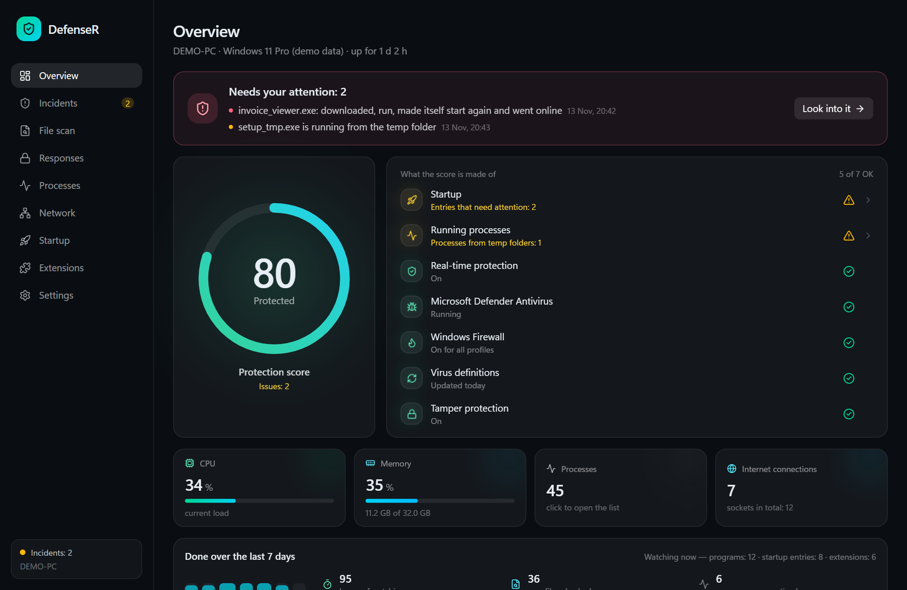
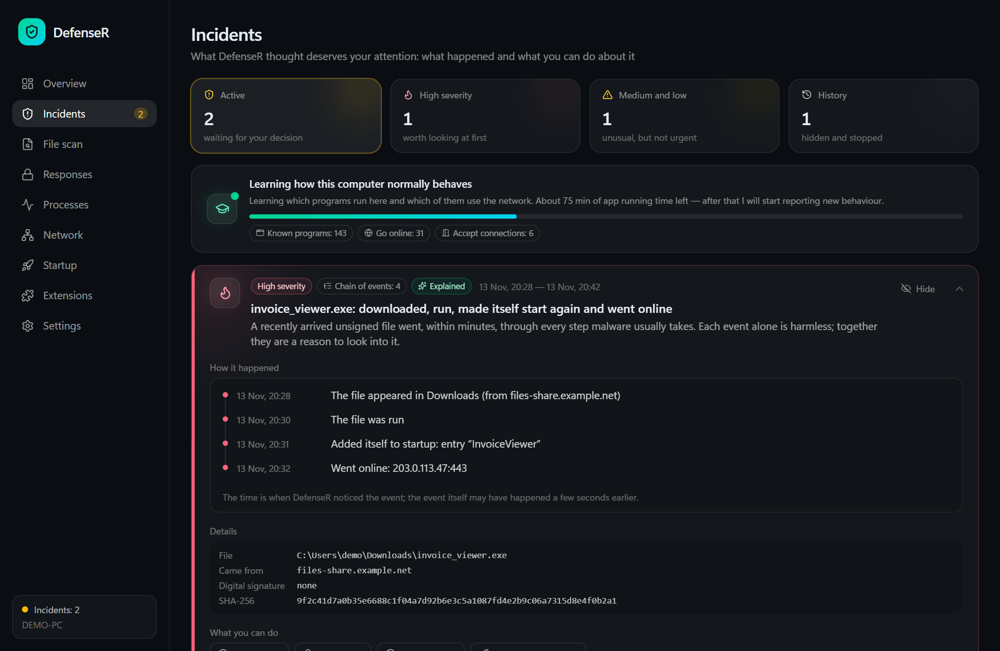
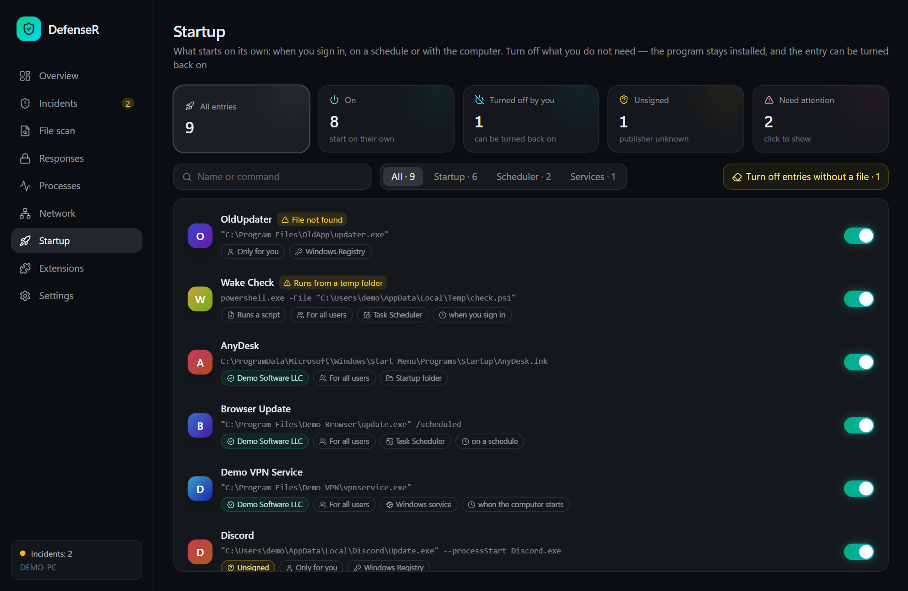
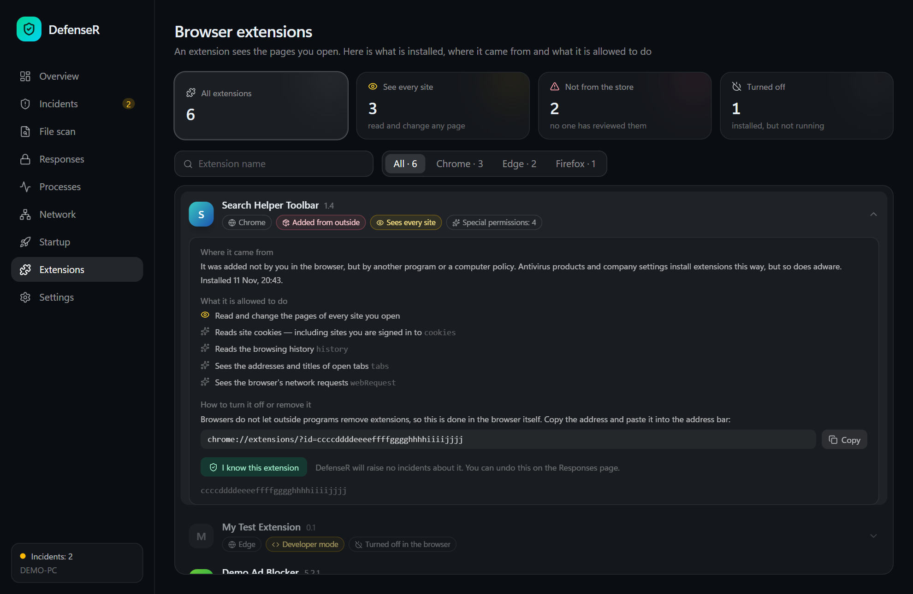
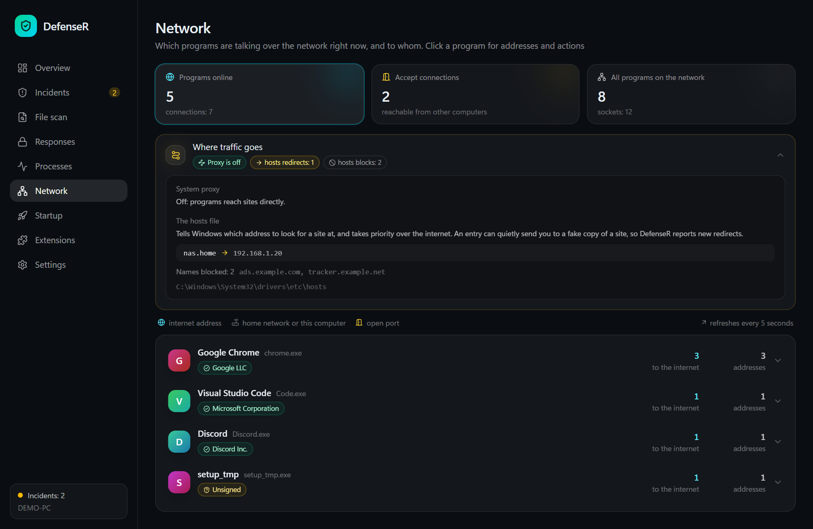
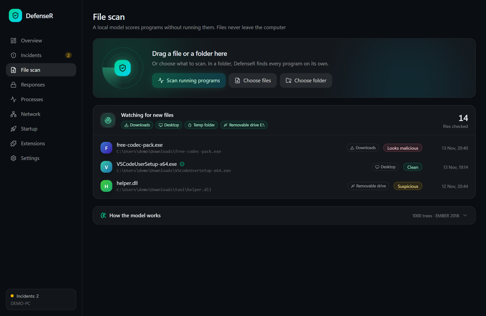
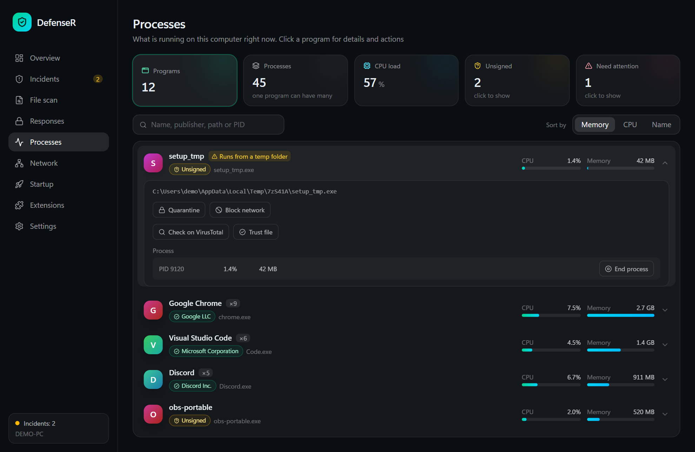
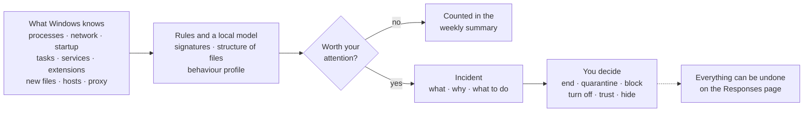
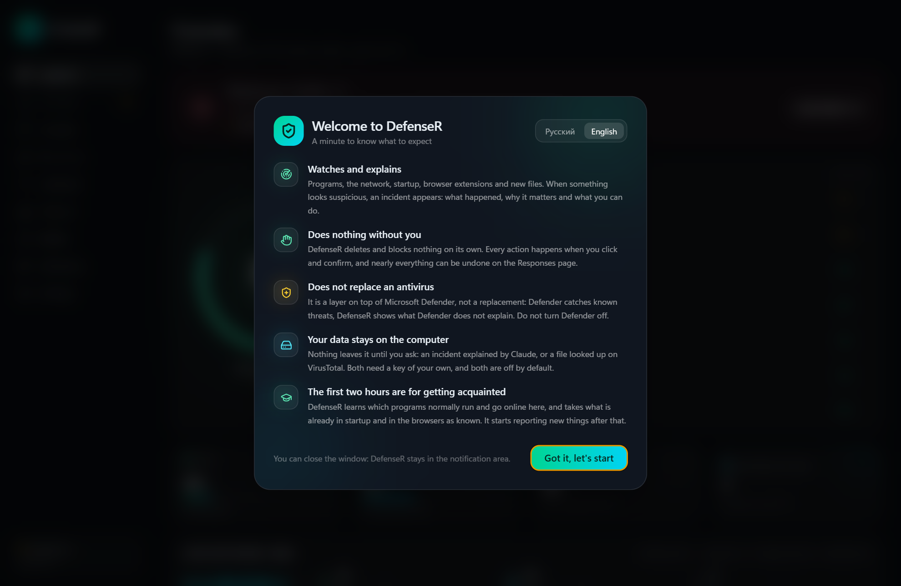

<div align="center">


# DefenseR

**A smart layer on top of Microsoft Defender for a home Windows PC.**<br>
It watches, explains what it sees in plain language, and acts only when you say so.

[](https://github.com/Nyan4eg/DefenseR/releases/latest)
[](https://github.com/Nyan4eg/DefenseR/actions/workflows/ci.yml)
[](https://github.com/Nyan4eg/DefenseR/releases)
[](LICENSE)


**[⬇ Download](https://github.com/Nyan4eg/DefenseR/releases/latest)** · [What it does](#what-it-does) · [Privacy](#privacy) · [Build](#building-from-source) · [Русский](README.ru.md)

<br>



</div>

<br>

> [!NOTE]
> DefenseR does not replace an antivirus and has no kernel driver. It is a personal project: Defender catches known threats, DefenseR shows you what Defender does not explain. Keep Defender on.

## Why

Windows quietly knows a lot about what is going on: which programs start on their own, which of them talk to the internet, what just landed in Downloads, what your browser extensions are allowed to read. It rarely tells you, and when it does, not in words a person can act on.

DefenseR puts that in one window and follows three rules:

- **Explain, don't alarm.** Every finding says what happened, why it matters and what you can do.
- **Nothing happens without you.** DefenseR never deletes or blocks on its own. Every action is a button you press and confirm, and nearly all of them can be undone.
- **Your data stays home.** Nothing leaves the computer unless you ask for it.

## What it does

<table>
<tr>
<td width="50%" valign="top">

### Incidents as stories

When a freshly downloaded unsigned file is run, adds itself to startup and goes online, you see **one story with a timeline** instead of three separate alerts. Claude can explain it in plain language if you add your own API key.

</td>
<td width="50%">

</td>
</tr>
<tr>
<td width="50%">

</td>
<td width="50%" valign="top">

### Everything that starts on its own

Registry entries, the Startup folder, **scheduled tasks and services** in one list, each with its publisher or an "Unsigned" mark. Turn any of them off with a switch and back on later. Leftovers of removed programs are swept in one click.

</td>
</tr>
<tr>
<td width="50%" valign="top">

### Browser extensions

What is installed in Chrome, Edge, Opera, Brave, Yandex Browser and Firefox, **where each came from and what it may see** — in words, not permission codes. A new extension from outside a store becomes an incident.

</td>
<td width="50%">

</td>
</tr>
<tr>
<td width="50%">

</td>
<td width="50%" valign="top">

### Who talks to whom

Connections grouped by program, ports named in words, programs that accept connections from other computers called out. The **hosts file and the system proxy** — two favourite places for interception — are watched for changes.

</td>
</tr>
<tr>
<td width="50%" valign="top">

### Files checked the moment they arrive

A local model (LightGBM trained on EMBER 2018) scores programs by their structure **without running them** and checks the digital signature. New files in Downloads, on the desktop, in the temp folder and on removable drives are checked on their own. Scripts and shortcuts are read for dangerous commands, ZIP archives are looked into without unpacking, and names like `invoice.pdf.exe` are flagged.

</td>
<td width="50%">

</td>
</tr>
<tr>
<td width="50%">

</td>
<td width="50%" valign="top">

### Programs, not process IDs

Hundreds of processes folded into the programs they belong to, with real icons, publishers and load meters. From any row: end it, quarantine its file, block its network access, or look the file up on VirusTotal (only its SHA-256 is sent).

</td>
</tr>
</table>

**And also:** a behaviour profile that learns which programs normally go online and reports new ones · out-of-the-way persistence places (launch takeover through IFEO, Winlogon, AppInit_DLLs, WMI subscriptions, rewritten browser shortcuts) · a weekly summary of what was checked · a scheduled weekly scan of the folders you choose · a one-file report for asking for help, with your name and folders taken out · a trusted list for files, publishers and extensions · a notification-area icon, Windows notifications, start with Windows · automatic signed updates · English and Russian.

## How a finding is made



Things that already exist when DefenseR first looks are taken as known, so you are told about what is **new**, not about everything you have installed over the years.

## Install

1. Download `DefenseR_x.y.z_x64-setup.exe` from the **[latest release](https://github.com/Nyan4eg/DefenseR/releases/latest)** and run it.
2. The installer is not signed with a publisher certificate, so SmartScreen shows a warning: **More info → Run anyway**.
3. On first start a short introduction tells you what to expect. For the first two hours DefenseR learns what is normal on your computer.

After that the app updates itself. An update is accepted only if its signature matches the public key built into the app.

<div align="center">

</div>

## Privacy

| What | Where it goes |
| --- | --- |
| Files, the process list, network connections, extensions | **Nowhere.** They never leave the computer. |
| A file's SHA-256 | VirusTotal — when you press the button, or automatically for files the model calls malicious **if you turn that on**. Needs your own key. |
| The text of one incident | Anthropic — only when you press "Explain with AI". The path to your profile folder is replaced with `%USERPROFILE%`. Needs your own key. |
| API keys | Windows Credential Manager, not the app's files. |
| Update checks | GitHub. |

## What it is not

- Not an antivirus: it does not remove malware on its own and has no kernel driver.
- Not a firewall: it can add a Windows Firewall rule for a program when you ask, nothing more.
- Not a guarantee. The model and the rules make mistakes in both directions; an incident is a reason to look, not a verdict.

## Building from source

You need Node.js, Rust and the [Tauri prerequisites](https://tauri.app/start/prerequisites/) for Windows.

```bash
npm install
npm run tauri dev
```

`npm run dev` alone opens the interface in a browser on demo data, which is how the screenshots above were made.

The trained model is in `src-tauri/model`. The scripts to retrain it are in `ml/`; the EMBER dataset is not part of the repository.

<details>
<summary><b>Project layout</b></summary>

| Path | What is there |
| --- | --- |
| `src/` | The interface: React, TypeScript, Tailwind |
| `src-tauri/src/collectors/` | Reading the system: processes, network, startup, tasks, services, extensions, hosts and proxy |
| `src-tauri/src/rules.rs`, `chains.rs`, `profile.rs` | Turning what was read into findings |
| `src-tauri/src/scanner/` | The file model, PE parsing and signature checks |
| `src-tauri/src/responses.rs`, `startup.rs` | The actions and how each is undone |
| `ml/` | Training the model |

</details>

<details>
<summary><b>Releasing a new version</b></summary>

1. Bump the version in `src-tauri/tauri.conf.json`, `src-tauri/Cargo.toml` and `package.json`, and commit.
2. Run `npm run release -- "What's new"`.

The script builds the installer, signs it with the key in `~/.tauri/defenser.key` and publishes the release on GitHub. The private key never enters the repository; without it, no update can be released for copies that are already installed.

Tests run on every commit in GitHub Actions; releases are built and signed on the maintainer's machine.

</details>

## License

[MIT](LICENSE)
