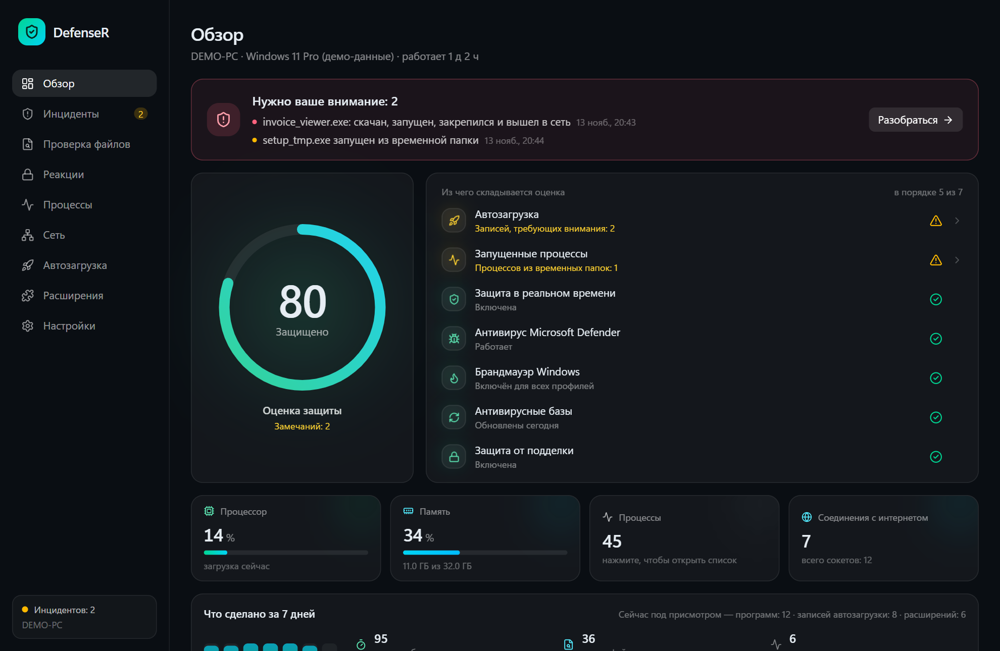
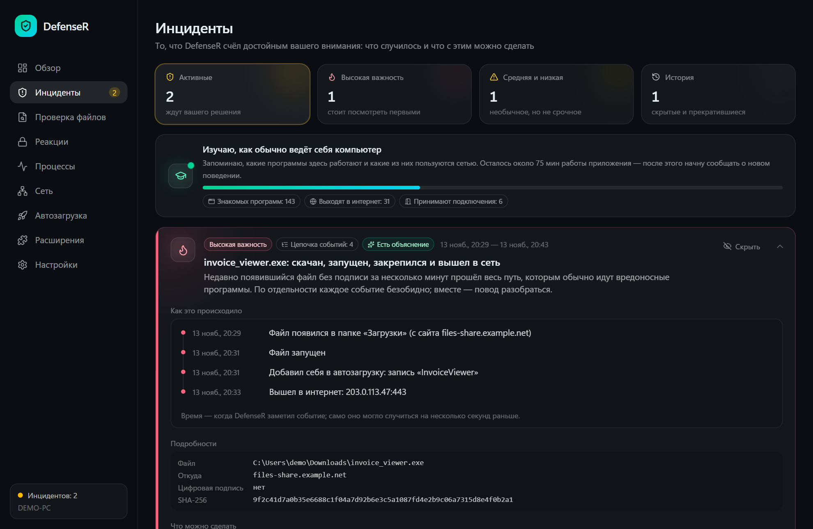
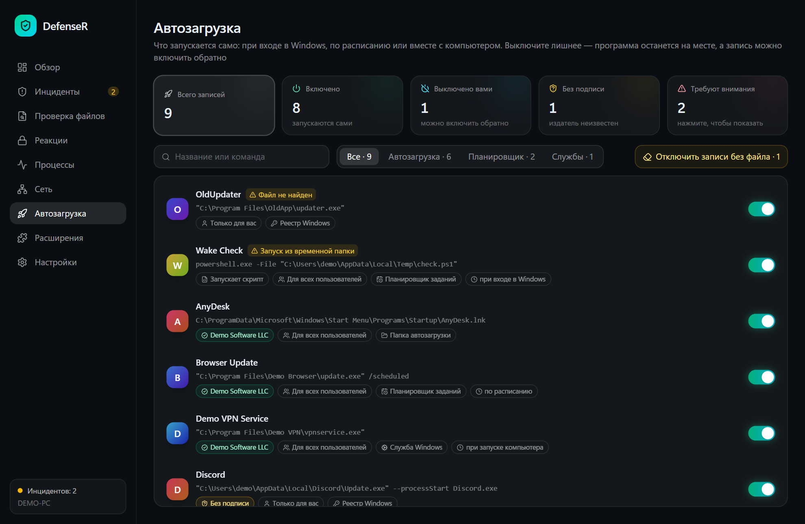
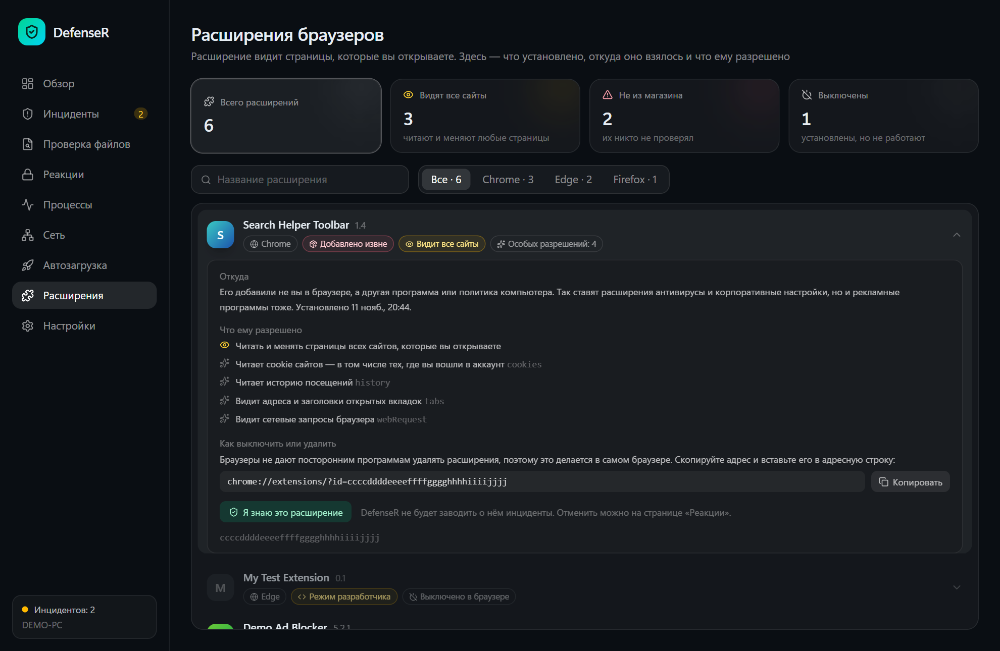
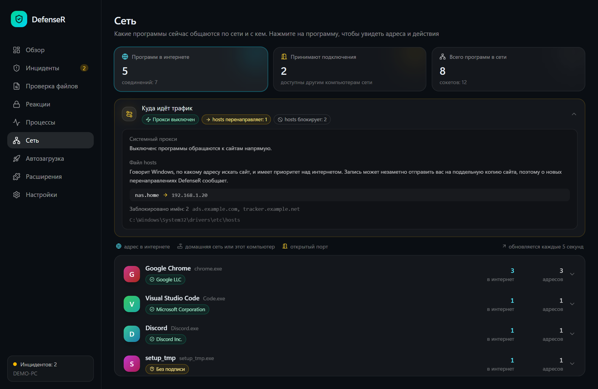
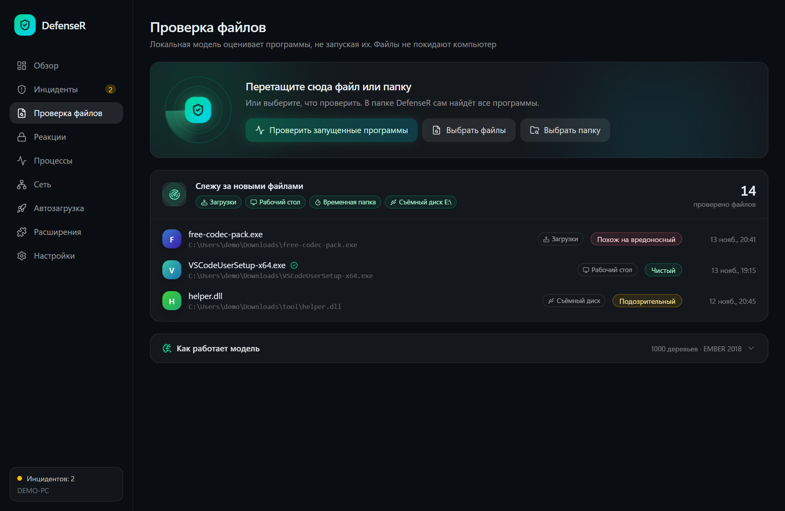
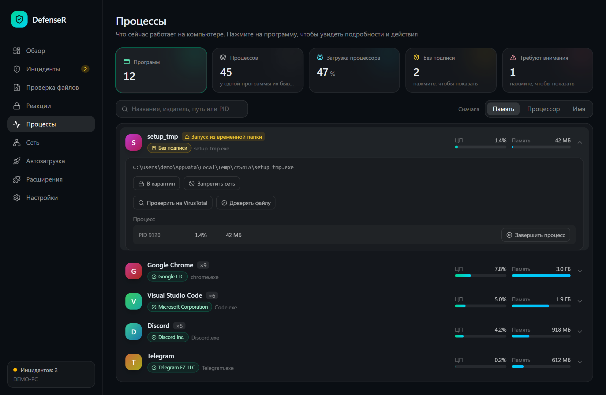
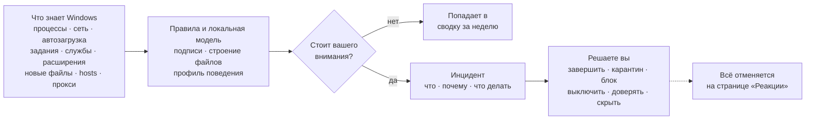
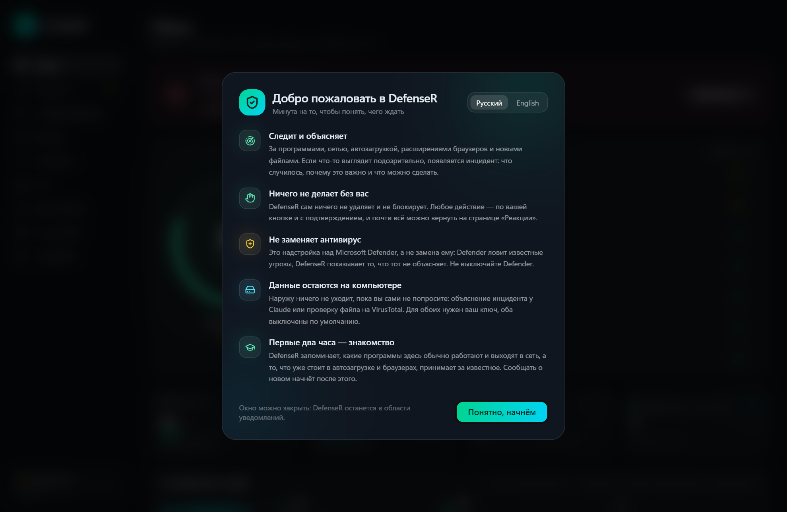

<div align="center">


# DefenseR

**Умная надстройка над Microsoft Defender для домашнего компьютера с Windows.**<br>
Следит, объясняет увиденное простым языком и действует только по вашей команде.

[](https://github.com/Nyan4eg/DefenseR/releases/latest)
[](https://github.com/Nyan4eg/DefenseR/actions/workflows/ci.yml)
[](https://github.com/Nyan4eg/DefenseR/releases)
[](LICENSE)


**[⬇ Скачать](https://github.com/Nyan4eg/DefenseR/releases/latest)** · [Что умеет](#что-умеет) · [Приватность](#приватность) · [Сборка](#сборка-из-исходников) · [English](README.md)

<br>



</div>

<br>

> [!NOTE]
> DefenseR не заменяет антивирус и не содержит драйвера ядра. Это личный проект: Defender ловит известные угрозы, DefenseR показывает то, что Defender не объясняет. Не выключайте Defender.

## Зачем

Windows знает о происходящем многое: какие программы запускаются сами, какие из них ходят в интернет, что только что появилось в «Загрузках», что разрешено читать расширениям браузера. Она редко об этом говорит, а когда говорит — не теми словами, по которым можно что-то решить.

DefenseR собирает это в одном окне и держится трёх правил:

- **Объяснять, а не пугать.** У каждой находки написано, что случилось, почему это важно и что можно сделать.
- **Ничего без вас.** DefenseR сам ничего не удаляет и не блокирует. Любое действие — кнопка, которую вы нажали и подтвердили, и почти каждое можно отменить.
- **Данные остаются дома.** С компьютера ничего не уходит, пока вы сами об этом не попросите.

## Что умеет

<table>
<tr>
<td width="50%" valign="top">

### Инциденты как истории

Когда только что скачанный файл без подписи запускается, прописывается в автозагрузку и выходит в сеть, вы видите **одну историю с хронологией**, а не три отдельных предупреждения. Claude объяснит её простым языком, если добавить свой ключ API.

</td>
<td width="50%">

</td>
</tr>
<tr>
<td width="50%">

</td>
<td width="50%" valign="top">

### Всё, что запускается само

Записи реестра, папка автозагрузки, **задания планировщика и службы** в одном списке, у каждой — издатель или пометка «Без подписи». Любую можно выключить переключателем и позже включить обратно. Остатки удалённых программ убираются одной кнопкой.

</td>
</tr>
<tr>
<td width="50%" valign="top">

### Расширения браузеров

Что установлено в Chrome, Edge, Opera, Brave, Яндекс Браузере и Firefox, **откуда оно взялось и что ему разрешено** — словами, а не кодами разрешений. Новое расширение не из магазина становится инцидентом.

</td>
<td width="50%">

</td>
</tr>
<tr>
<td width="50%">

</td>
<td width="50%" valign="top">

### Кто с кем общается

Соединения сгруппированы по программам, порты названы словами, отдельно показаны программы, принимающие подключения с других компьютеров. **Файл hosts и системный прокси** — два любимых места для перехвата трафика — отслеживаются на изменения.

</td>
</tr>
<tr>
<td width="50%" valign="top">

### Файлы проверяются, как только появились

Локальная модель (LightGBM, обучена на EMBER 2018) оценивает программы по их строению, **не запуская их**, и проверяет цифровую подпись. Новые файлы в «Загрузках», на рабочем столе, во временной папке и на флешках проверяются сами. Скрипты и ярлыки читаются на опасные команды, в архивы ZIP программа заглядывает без распаковки, а имена вроде `счёт.pdf.exe` отмечаются.

</td>
<td width="50%">

</td>
</tr>
<tr>
<td width="50%">

</td>
<td width="50%" valign="top">

### Программы, а не номера процессов

Сотни процессов свёрнуты в программы, которым они принадлежат, с настоящими значками, издателями и полосками загрузки. Из любой строки: завершить, убрать файл в карантин, запретить выход в сеть или проверить файл на VirusTotal (отправляется только его SHA-256).

</td>
</tr>
</table>

**А ещё:** профиль поведения, который запоминает, какие программы обычно выходят в сеть, и сообщает о новых · скрытые места закрепления (подмена запуска через IFEO, Winlogon, AppInit_DLLs, подписки WMI, переписанные ярлыки браузеров) · сводка за неделю · еженедельная проверка выбранных папок по расписанию · отчёт одним файлом для обращения за помощью, без вашего имени и папок · список доверенных файлов, издателей и расширений · значок в области уведомлений, уведомления Windows, запуск вместе с системой · автоматические подписанные обновления · русский и английский языки.

## Как появляется находка



То, что уже есть на компьютере при первом запуске, принимается за известное: вам сообщают о **новом**, а не обо всём, что накопилось за годы.

## Установка

1. Скачайте `DefenseR_x.y.z_x64-setup.exe` со страницы **[последнего выпуска](https://github.com/Nyan4eg/DefenseR/releases/latest)** и запустите.
2. Установщик не подписан сертификатом издателя, поэтому SmartScreen покажет предупреждение: **«Подробнее» → «Выполнить в любом случае»**.
3. При первом запуске короткое знакомство расскажет, чего ждать. Первые два часа DefenseR изучает, что для вашего компьютера нормально.

Дальше программа обновляется сама. Обновление принимается, только если его подпись сходится с открытым ключом, вшитым в приложение.

<div align="center">

</div>

## Приватность

| Что | Куда уходит |
| --- | --- |
| Файлы, список процессов, сетевые соединения, расширения | **Никуда.** Они не покидают компьютер. |
| SHA-256 файла | В VirusTotal — по кнопке или автоматически для файлов, которые модель сочла вредоносными, **если вы это включили**. Нужен свой ключ. |
| Текст одного инцидента | В Anthropic — только по кнопке «Объяснить с помощью ИИ». Путь к папке профиля заменяется на `%USERPROFILE%`. Нужен свой ключ. |
| Ключи API | В диспетчер учётных данных Windows, а не в файлы приложения. |
| Проверка обновлений | На GitHub. |

## Чем DefenseR не является

- Это не антивирус: он не удаляет вредоносные программы сам и не содержит драйвера ядра.
- Это не брандмауэр: по вашей просьбе он может добавить правило в брандмауэр Windows для одной программы, не больше.
- Это не гарантия. Модель и правила ошибаются в обе стороны; инцидент — повод посмотреть, а не приговор.

## Сборка из исходников

Нужны Node.js, Rust и [зависимости Tauri](https://tauri.app/start/prerequisites/) для Windows.

```bash
npm install
npm run tauri dev
```

Одна команда `npm run dev` открывает интерфейс в браузере на демо-данных — так сделаны снимки выше.

Обученная модель лежит в `src-tauri/model`. Скрипты для переобучения — в `ml/`; сам набор данных EMBER в репозиторий не входит.

<details>
<summary><b>Устройство проекта</b></summary>

| Путь | Что там |
| --- | --- |
| `src/` | Интерфейс: React, TypeScript, Tailwind |
| `src-tauri/src/collectors/` | Чтение системы: процессы, сеть, автозагрузка, задания, службы, расширения, hosts и прокси |
| `src-tauri/src/rules.rs`, `chains.rs`, `profile.rs` | Превращение прочитанного в находки |
| `src-tauri/src/scanner/` | Модель для файлов, разбор PE и проверка подписей |
| `src-tauri/src/responses.rs`, `startup.rs` | Действия и то, как каждое отменяется |
| `ml/` | Обучение модели |

</details>

<details>
<summary><b>Выпуск новой версии</b></summary>

1. Поднять версию в `src-tauri/tauri.conf.json`, `src-tauri/Cargo.toml` и `package.json`, закоммитить.
2. Запустить `npm run release -- "Что нового"`.

Скрипт собирает установщик, подписывает его ключом из `~/.tauri/defenser.key` и публикует выпуск на GitHub. Закрытый ключ в репозиторий не попадает; без него выпустить обновление для уже установленных копий нельзя.

Тесты запускаются на каждый коммит в GitHub Actions; выпуски собираются и подписываются на компьютере автора.

</details>

## Лицензия

[MIT](LICENSE)
